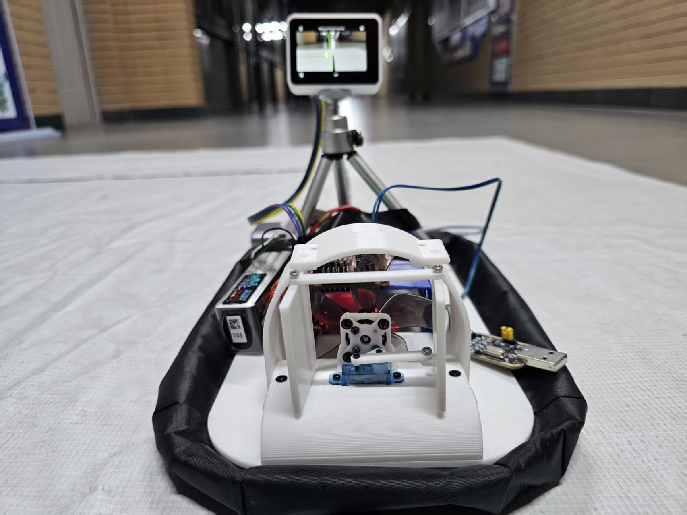

“基于高速轴流风机的气垫悬浮车”是我担任负责人的大学生创新训练计划项目。项目已完成省级大创结项。对我而言，它也是一次将软件、驱动和实物系统联系起来的实践。

## 我的工作

在项目中，我承担软件设计和无刷电调驱动工作，与团队共同完成系统搭建和调试。除了自己的技术任务，作为项目负责人，我也需要关注分工和整体进度，让不同部分逐步组合成完整的系统。

## 从模块走向系统

系统开发带来的一个直接感受是：单独完成某个模块，只是过程中的一部分。程序需要与硬件配合，驱动需要在实物上验证，多个部分连接起来后，还要继续检查整体运行情况。

这些工作让我认识到，动手能力和理解原理需要一起积累。遇到问题时，先把观察到的现象说清楚，再检查相关环节，通过实验检验自己的判断，会比盲目修改更有帮助。

## 作为负责人的收获

项目让我积累了协调分工、推进系统开发的经验，也让我更加理解团队沟通的重要性。每个人承担不同任务，但需要对共同目标有一致的认识。把自己的进展和问题及时讲清楚，才能让合作更顺畅。

2026 年，我主持的“基于 MSPM0 系列单片机的自动行驶小车”项目也获得省级大创立项。我希望把已有经验继续用到新的任务中，在软硬件设计与调试中进一步提高解决问题的能力。
